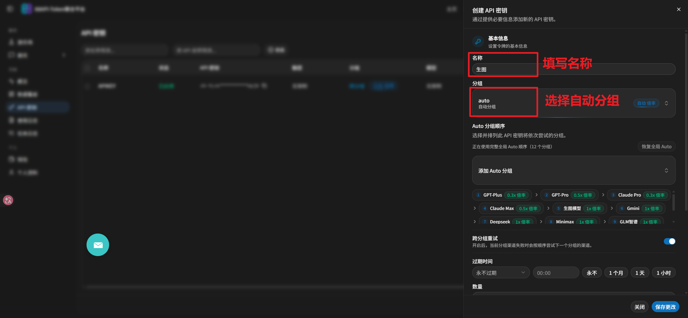
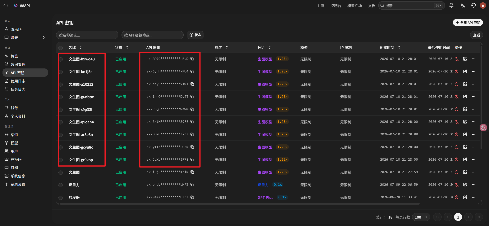

# 88API-Nano-Banana

来自 [88api.ai](https://88api.ai/) Token 聚合站的 Gemini 生图插件。它通过 **OpenAI Chat Completions** 协议生成和编辑图片，并将结果直接保存到本地。

插件集成两款图片模型：

| 模型 | 定位 | 适合场景 |
| --- | --- | --- |
| `gemini-3.1-flash-image`（默认） | 速度与效率优先 | 日常文生图、快速迭代、常规参考图编辑 |
| `gemini-3-pro-image` | 细节与复杂任务优先 | 高细节画面、复杂构图、精细文字排版、复杂参考图编辑 |

普通任务会直接使用 Flash。用户明确要求高细节、最高质量、复杂构图、精细排版或复杂参考图编辑，但没有指定模型时，插件会在请求 API 前询问是否切换到 Pro；只有确认后才会使用 Pro。单次选择不会改写以后任务的默认模型。

支持 **Codex、Claude Code、ZCode、DeepSeek Harness**，以及 Cursor、Cline、Windsurf、VS Code Copilot、Gemini CLI 等能读取 `SKILL.md` 技能、能运行本机 Node.js 命令的 Agent 客户端。

v1.4.0 起不再只限 Codex：新增 Claude Code / ZCode 插件清单，技能文件夹自带脚本可直接复制到其它客户端；Key 改存客户端通用的 `~/.88api/nano-banana.json`（旧配置自动迁移）；失败按“未发出 / 提交后状态未知 / 已计费但读取失败 / 下载失败”分阶段报错；每次付费运行都留提交记录，客户端超时中断后可用 `--job-status` 查清哪些已出图、哪些可能已扣费。

插件独立于 `88API-Image-Gen`，配置文件分开保存（可以填同一个 auto 分组 Key）。

## 选择适合你的方式

| 方式 | 适合场景 | 入口 |
| --- | --- | --- |
| Agent 插件（本项目） | 在 Codex、Claude Code、ZCode 等 Agent 客户端中用自然语言生成或编辑图片，适合参考图、重复任务、自动化和本地落盘 | <https://github.com/blackdm666/88api-Nano-Banana> |
| 简单生图工具 | 无需安装，在浏览器中填写提示词、调整参数、上传参考图并复用历史任务 | <https://img.88api.ai/> |
| 专业画布工具 | 适合复杂创作流程、图像与视频项目、提示词库、资产管理和 Agent 辅助任务 | <https://img-pro.88api.ai/> |

只想快速出一张图时使用简单生图工具；需要可视化管理素材和多步骤创作时使用专业画布；希望让 Agent 理解需求并自动执行、保存文件时使用本插件。

## API 协议

从 `v1.3.0` 开始，插件仅使用 OpenAI Chat Completions 协议：

| 场景 | 端点 | 请求格式 |
| --- | --- | --- |
| 文生图 | `https://88api.ai/v1/chat/completions` | JSON，`messages` 使用文本内容 |
| 参考图编辑 | `https://88api.ai/v1/chat/completions` | JSON，`messages` 使用文本与 `image_url` 内容块 |

请求使用 `Authorization: Bearer <KEY>` 和 `Content-Type: application/json`。

核心请求格式：

```json
{
  "model": "gemini-3.1-flash-image",
  "messages": [
    {
      "role": "user",
      "content": "生成一张图片：纯白背景，中央只有一个蓝色圆形，不要文字。"
    }
  ],
  "modalities": ["text", "image"],
  "extra_body": {
    "google": {
      "image_config": {
        "aspect_ratio": "16:9",
        "image_size": "4K"
      }
    }
  }
}
```

- `aspect_ratio` 支持 `1:1`、`2:3`、`3:2`、`3:4`、`4:3`、`4:5`、`5:4`、`9:16`、`16:9`、`21:9`。
- `image_size` 支持 `1K`、`2K`、`4K`。
- 参考图会按输入顺序转换成 `image_url` Data URI，与文字一起放入同一条用户消息。
- Pro 等长任务使用原始 HTTPS/1.1、`Accept-Encoding: identity`、10 分钟超时和每 15 秒本地心跳，避免高层 `fetch` 解码或无输出等待导致连接提前中断。Gemini 图片渠道不启用 `stream: true`。

## 环境

- 上述任一 Agent 客户端
- Node.js 18 或更高版本
- 能通过 OpenAI Chat Completions 调用上述 Gemini 图片模型的 88api.ai Key

## 创建并配置 88API Key

### 1. 注册账号

打开 [88api.ai](https://88api.ai/) 注册账号并登录。

### 2. 创建 API Key

进入“API 密钥”，点击“创建 API 密钥”。名称可以自定义（例如“生图”），分组选择 `auto`（自动分组）；如需在当前分组渠道失败时继续尝试下一分组，可开启“跨分组重试”。



### 3. 复制 Key

复制创建好的完整 Key。



### 4. 让 Agent 一键配置（推荐）

安装插件后，直接向 **88API-Nano-Banana** 描述生图或改图需求。Agent 会先自动检查 Key；如果尚未配置，它会主动请你提供完整 Key。你只需把 Key 发给 Agent，Agent 会自动保存、脱敏核验并继续原任务，不需要打开 PowerShell。

配置保存在 `~/.88api/nano-banana.json`，本机所有 Agent 客户端共用。旧版保存在 `~/.codex/88api-nano-banana-config.json` 的 Key 会在第一次使用时自动复制过来，旧文件保留并同步更新，旧版插件仍可使用。Agent 不会在回复中显示完整 Key，验证过程也不会发起付费生图请求。

只在自己信任的 Agent 对话中提供 Key，不要发布到 GitHub Issue、公开聊天、仓库文件或截图中。发给 Agent 的 Key 可能留在客户端的对话记录里；不想发送时，可以改为设置环境变量 `API88_KEY`（优先于配置文件，不写入磁盘）。

<details>
<summary>高级用户：手动配置命令</summary>

```powershell
node "<SKILL_DIR>\scripts\generate.mjs" --set-key "<YOUR_88API_GEMINI_IMAGE_KEY>"
node "<SKILL_DIR>\scripts\generate.mjs" --get-config
```

</details>

## 安装

`<SKILL_DIR>` 指技能文件夹 `plugins/88api-nano-banana/skills/88api-nano-banana/`，脚本就在其中的 `scripts/generate.mjs`。

### Codex

首次安装使用 Codex 标准 marketplace 流程：

```powershell
codex plugin marketplace add blackdm666/88api-Nano-Banana
codex plugin add 88api-nano-banana@88api-nano-banana
codex plugin list --json
```

已添加过该 marketplace 时，先刷新仓库快照，再重新安装插件版本：

```powershell
codex plugin marketplace upgrade 88api-nano-banana
codex plugin add 88api-nano-banana@88api-nano-banana
codex plugin list --json
```

`plugin list` 中应显示 `88api-nano-banana` 已安装并启用。安装或升级后必须新建 Codex 任务，使插件和技能列表重新加载。

### Claude Code

```text
/plugin marketplace add blackdm666/88api-Nano-Banana
/plugin install 88api-nano-banana@88api-nano-banana
```

也可以在终端运行 `claude plugin marketplace add blackdm666/88api-Nano-Banana` 和 `claude plugin install 88api-nano-banana@88api-nano-banana`。安装后直接描述需求即可。

### ZCode

ZCode 兼容 Claude Code 插件格式：打开 **设置 → Plugins → Create → Add marketplace**，填入 `blackdm666/88api-Nano-Banana`，然后安装 **88api-nano-banana**。

### DeepSeek Harness、Cursor、Cline 等其它客户端

整个技能文件夹 `plugins/88api-nano-banana/skills/88api-nano-banana/`（含 `SKILL.md` 和 `scripts/generate.mjs`）就是完整的安装包，复制到客户端的技能目录即可，例如：

| 客户端 | 用户级技能目录 |
| --- | --- |
| DeepSeek Harness | `~/.dsh/skills/` 或 `~/.agents/skills/` |
| Cursor、Codex、Gemini CLI 等认公共目录的客户端 | `~/.agents/skills/` |
| Cline | `~/.cline/skills/` |
| ZCode（不用插件时） | `~/.zcode/skills/` |

复制后保持文件夹名为 `88api-nano-banana`，新开对话让客户端重新加载技能。DeepSeek Harness 也可以继续使用原生插件 [dsh-plugin-88api-image](https://github.com/blackdm666/dsh-plugin-88api-image)。

## 长任务与中断

Pro 或 4K 图片可能要好几分钟，批量更久，而不少客户端会更早结束命令（例如 Claude Code 的命令默认 2 分钟超时）。命令被结束时，请求可能已经被 88API 受理并扣费。

- 技能已要求 Agent 在 Claude Code 中把付费命令放到后台运行，其它客户端也优先用后台 / 长命令。
- 每次付费运行开头会打印 `提交记录` 和任务号，记录保存在 `~/.88api/nano-banana-jobs/`。
- 命令中断、超时或看不清结果时，运行 `--job-status <任务号>`（不带参数列出最近几次）查看每个请求的实际状态：已保存、未发出、88API 拒绝、仍在运行，或 `[NO-AUTO-RETRY]` 状态未知 / 被中断（可能已扣费）。这个命令不发请求、不收费。
- 失败会注明阶段：`request was not sent`（请求未发出）没有扣费，可以直接重新提交；`stage: submit` 状态未知；`stage: read-result` 已计费但读取失败；`stage: download` 已计费但结果图下载失败，按报错提示运行 `--retry-download <链接文件>` 可免费再下载一次。
- `--json` 会在付费运行结束时多输出一行机器可读的结果，格式和 `--job-status` 相同。

## 在 Codex 中通过 @ 调用

在新任务的输入框中输入 `@`，从菜单中选择 **88API-Nano-Banana**，然后继续写自然语言需求。例如：

```text
@88API-Nano-Banana 生成一张 16:9 的科技产品海报，4K。
```

如果 `@` 菜单里没有出现插件，依次确认：

1. `codex plugin list --json` 中插件是 `installed`、`enabled`。
2. marketplace 已通过 `codex plugin marketplace upgrade 88api-nano-banana` 刷新。
3. 安装或升级后已经新建任务，而不是继续使用升级前打开的旧任务。

## 使用

不指定 `--model` 时使用保存的默认模型；首次安装的默认值是 `gemini-3.1-flash-image`。一次任务需要 Pro 时传入 `--model gemini-3-pro-image`，只有明确要求改变长期默认时才使用 `--set-model`。

文生图：

```powershell
node "<SKILL_DIR>\scripts\generate.mjs" --prompt "在太空中挥手的布偶猫，背景是地球" --aspect 16:9 --resolution 1K
```

参考图编辑：

```powershell
node "<SKILL_DIR>\scripts\generate.mjs" --model gemini-3-pro-image --image "<参考图.png>" --prompt "保持主体身份，改成电影海报" --aspect 9:16 --resolution 2K
```

批量生成不同提示词（顺序执行，整批只启动一次插件进程）：

```powershell
node "<SKILL_DIR>\scripts\generate.mjs" --batch-inline "第一张提示词" "第二张提示词" "第三张提示词" --aspect 16:9 --resolution 1K
```

也可以用 `--batch prompts.json`，文件内容为字符串数组或 `{ "prompts": [...] }`。最多支持 20 条提示词；每条仍是独立付费请求。相同提示词的多张方案继续使用 `--count 1..4`。

两张及以上图片必须先整理完整任务清单，再通过一条 `--count`、`--batch-inline` 或 `--batch` 命令提交。不要每张图片分别启动一次插件进程，否则 Auto 模式可能反复触发外网审批，导致后续任务尚未到达 88API 就被拦截。

比例和分辨率是请求目标，不是本地强制缩放。对尺寸有硬性要求时应检查最终文件；88API 或上游模型可能调整输出尺寸。

## 超长文本图片解析

正常响应从 Chat Completions 的消息内容或图片字段中读取图片。如果 88API 把图片包装在百万字符级 Markdown/Data URI 文本中，插件仍会在 128 MB 响应上限内：

- 解析 Markdown/Data URI 和 URL-safe Base64；
- 从摘要和错误中移除 Base64；
- 多个文本候选仅保留最后一张成品图；
- 对最终图片进行内容哈希去重。

## 安全测试

以下命令不会请求付费 API：

```powershell
node --check "<SKILL_DIR>\scripts\generate.mjs"
node "<SKILL_DIR>\scripts\generate.mjs" --self-test
node "<SKILL_DIR>\scripts\generate.mjs" --prompt "测试" --dry-run
node "<SKILL_DIR>\scripts\generate.mjs" --image "<参考图.png>" --prompt "测试编辑" --dry-run
```

每个 `--count` 都是独立云端请求。本地卡死、客户端崩溃或超时、断网或图片未保存，不代表云端任务取消；已经受理或完成的请求仍可能计费。`[NO-AUTO-RETRY]` 只禁止插件自动重发；用户了解风险后明确说“重试/重新生成/再试一次”，Agent 应直接提交 1 次新请求，不强制先查使用日志。

## Auto 模式与外网审批

Codex Auto 模式可能在插件访问网络前发起外网执行审批。若错误明确包含“外部网络执行授权”“沙箱网络权限”“审批服务”或审批服务的 `429 Too Many Requests`，它不是 88API、Key、渠道或模型返回的限流。

被审批层拦截且尚未出现 `[序号/总数] 正在向 88API 提交图片请求` 的任务没有发送到 88API，因此 88API 没有对应日志，也不会产生这部分费用；此前已经被 88API 受理的任务仍按实际结果计费。

需要避免重复审批时：

1. Windows 按 `Ctrl+,` 打开 Codex 设置。
2. 进入 **General（通用）→ Permissions（权限）** 并启用 **Full access（完全访问）**。
3. 回到任务，在输入框下方的权限菜单中选择 **Full access（完全访问）**。
4. 将剩余图片通过一条 `--batch-inline` 或 `--batch` 命令重新提交。

**安全提示：**Full access（完全访问）会取消当前任务的本地沙箱与审批边界。插件只提供解释和操作步骤，不会自动修改全局 Codex 权限。如果该选项不可用或呈灰色，可能是组织策略限制；此时使用单条批量命令，并只审批一次正式外网执行。

## 项目信息

- 版本：`1.4.0`
- GitHub：[blackdm666/88api-Nano-Banana](https://github.com/blackdm666/88api-Nano-Banana)
- 插件：`88api-nano-banana@88api-nano-banana`（Codex、Claude Code、ZCode 同名）
- 更新说明：[docs/更新说明-v1.4.0.md](docs/更新说明-v1.4.0.md)；[v1.3.6](docs/更新说明-v1.3.6.md)
